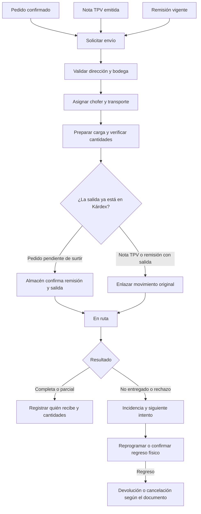

# Diseño de Logística para ERP JM

Una **solicitud de envío** conecta Ventas, Almacén y Logística. Ventas captura la entrega desde el documento comercial. Logística asigna chofer y transporte y registra el resultado. Cada solicitud conserva sus partidas, el documento origen y el almacén que realmente surte.

| Documento origen | Acción de Logística | Efecto en almacén |
| --- | --- | --- |
| Pedido institucional confirmado | Solicitar las partidas pendientes y programar entrega. Si se surte en dos bodegas, separar los envíos y sus partidas. | La solicitud permite reservar. La remisión autorizada descuenta las cantidades reales. |
| Nota TPV | Solicitar el envío de la nota emitida. Usar la bodega que quedó grabada al emitir. | La salida ya pertenece al ticket. Despachar y entregar solo registran el estado del envío. |
| Remisión vigente | Asociar la remisión y su salida. Si corresponde a una solicitud previa del pedido, completarla con esta remisión. | La remisión conserva el movimiento original. |
| Entrega parcial o rechazada | Registrar por partida lo entregado, lo pendiente y lo que regresa. | La recepción de lo que físicamente regresa sigue el flujo de devolución, cancelación TPV o cuarentena que corresponda. |

El diseño usa una bandeja de envíos con filtros por empresa, sucursal, fecha, estado y chofer. El folio muestra las etapas **Solicitado → Programado → Listo → En ruta → Entregado**. Incidencia y entrega parcial conservan el saldo pendiente y permiten reprogramar. Antes de cargar, validar que el documento siga vigente y que la cantidad que se va a enviar no esté comprometida en otra solicitud. Una vez en ruta, el resultado debe quedar registrado por partida.

| Rubro | Campos propuestos |
| --- | --- |
| Entrega capturada por Ventas | Cliente o destinatario, contacto, teléfono, calle, número, colonia, municipio, estado, CP, referencias, fecha y ventana de recepción. |
| Bodega de origen | Empresa, sucursal, almacén y dirección propia. Si falta la dirección, pedir que se configure antes de validar una ruta. |
| Chofer asignado | Nombre, teléfono operativo, estado activo, tipo y vigencia de licencia, usuario opcional para registrar entregas. |
| Transporte | Unidad propia o tercero, nombre del transportista, número económico, placas, tipo, capacidad en kg y m³, vigencia de seguro, guía externa opcional. |
| Viaje y entrega | Fecha y hora, chofer y unidad, bultos, peso, dirección confirmada, kilómetros estimados o manuales con su fuente, recibidor, evidencia e incidencias. |

Ventas consulta sus propias solicitudes, Almacén valida preparación y regreso físico, Logística administra las asignaciones dentro de su empresa y sucursal, y Gerencia revisa el conjunto autorizado. Las reasignaciones, cambios de domicilio e incidencias conservan fecha y responsable. Reportes iniciales: pendientes por sucursal, entregas a tiempo, entregas parciales o fallidas, viajes por chofer o unidad y distancia estimada frente a kilómetros reales.

La opción inicial de **Abrir ruta en Google Maps** usa la dirección registrada de la bodega como origen y el domicilio de entrega confirmado como destino. Permite validar el trayecto sin clave de API. Logística puede registrar los kilómetros revisados y su fuente. [Google Maps URLs](https://developers.google.com/maps/documentation/urls/get-started)

La opción de **Calcular distancia y duración en el ERP** usa Compute Routes desde el servidor. Requiere un proyecto con facturación y una clave restringida. Se ejecuta a petición, con cuota y captura manual disponible si falta conexión. La consulta se limita a origen y destino. Antes de persistir resultados de Google, revisar las condiciones de uso aplicables. [Compute Routes](https://developers.google.com/maps/documentation/routes/compute_route_directions) · [Facturación y cuotas](https://developers.google.com/maps/documentation/routes/usage-and-billing)

La separación entre planificación y salida se basa en el flujo de entregas de SAP y Oracle. Para el ERP JM se mantiene una sola solicitud comercial y se reutiliza la remisión existente para surtir pedidos. Una fase posterior puede agrupar entregas en un viaje, ordenar paradas y asignar transportistas externos. [SAP Business One Delivery](https://help.sap.com/docs/PRODUCT_ID/68a2e87fb29941b5bf959a184d9c6727/44fd94c693202463e10000000a1553f7.html) · [Oracle Inventory Sales and Fulfillment](https://docs.oracle.com/en/cloud/saas/netsuite/ns-online-help/section_N2281204.html)

Este documento define el flujo y los campos de Logística para su implementación. El TPV y la remisión ya son los puntos de integración del Kárdex.
